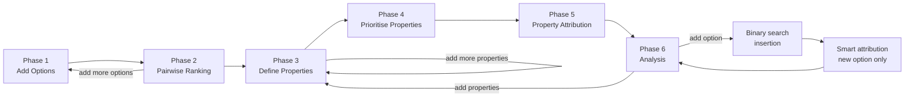
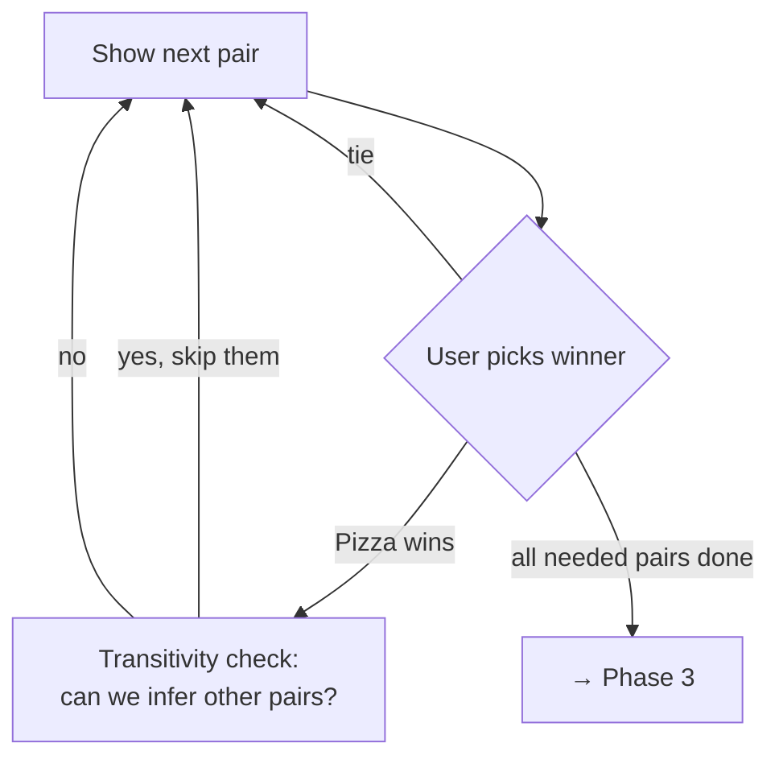
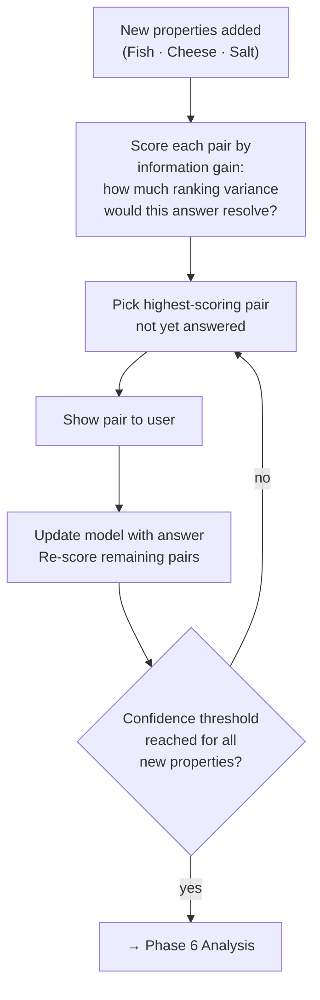
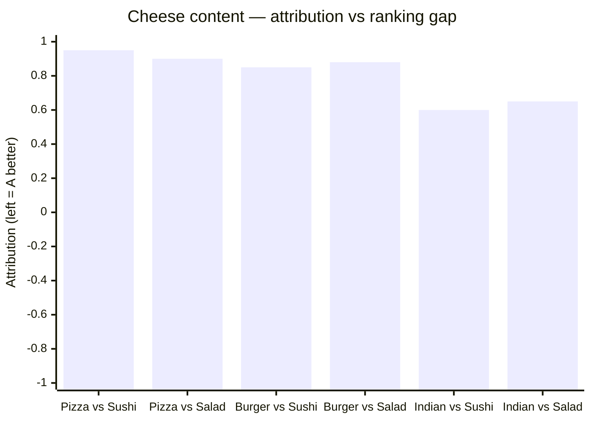
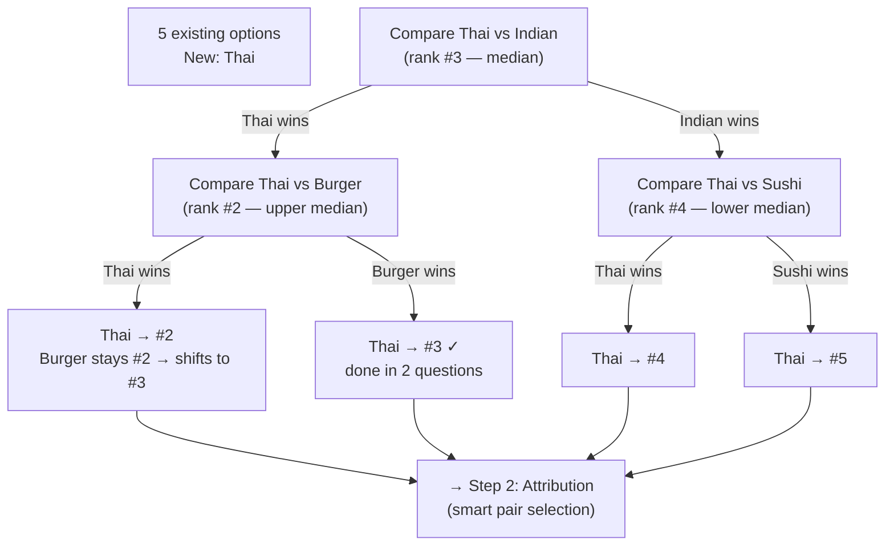
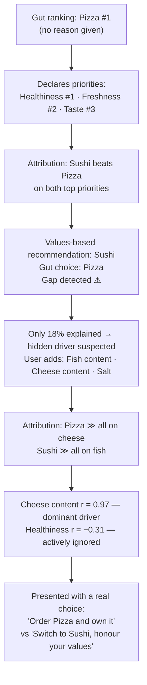
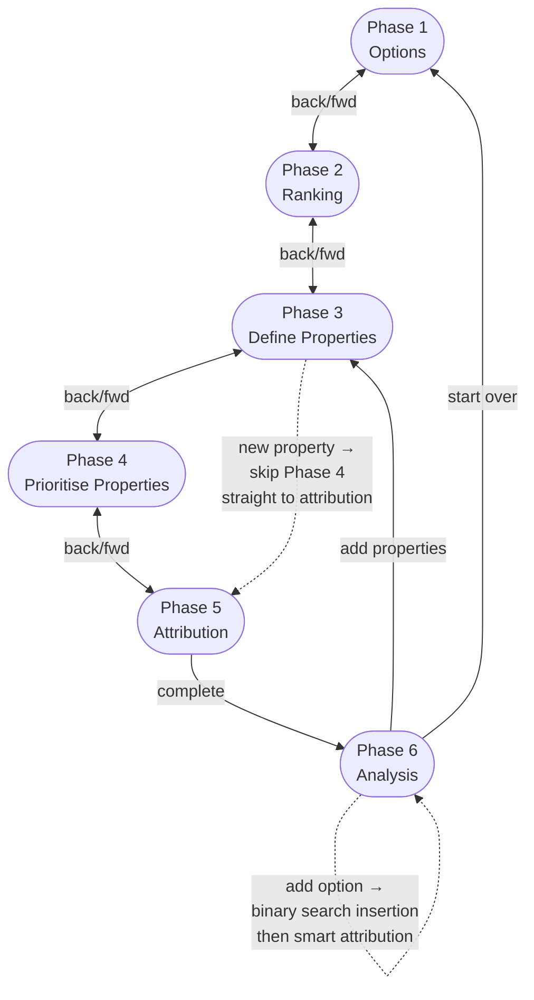
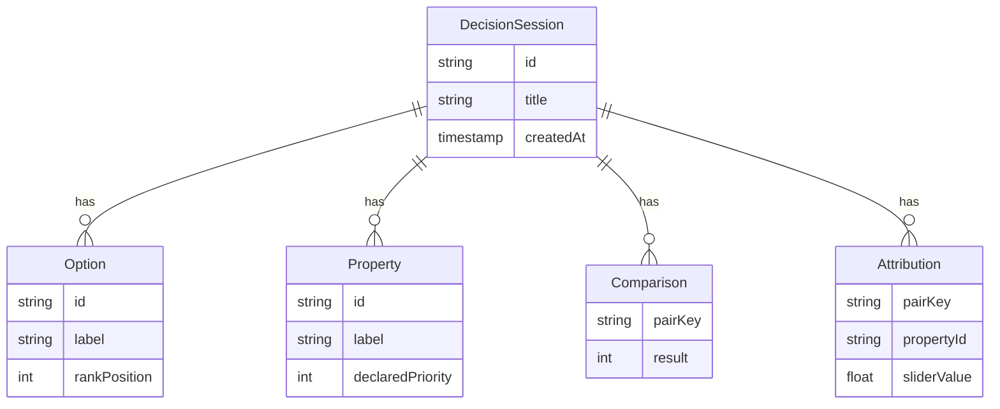

# DecisionHelper — Paper Prototype

> **Scenario:** A user picks what food to order tonight. They feel drawn to pizza but can't articulate why. After ranking their properties by importance and running attribution, the app shows their declared values point to Sushi — not Pizza. Digging deeper reveals a hidden preference for cheese as the true driver.

---

## User Flow Overview



---

## Phase 1 — Add Options

```
┌─────────────────────────────────────────────┐
│  DecisionHelper                          ⋮  │
│─────────────────────────────────────────────│
│                                             │
│  What are you deciding between?             │
│                                             │
│  ┌─────────────────────────────────────┐   │
│  │  e.g. "Sushi"                       │   │
│  └─────────────────────────────────────┘   │
│                       [ + Add Option ]      │
│                                             │
│  ── Your options ──────────────────────     │
│                                             │
│  ● Pizza                         [ × ]      │
│  ● Sushi                         [ × ]      │
│  ● Indian                        [ × ]      │
│  ● Burger                        [ × ]      │
│  ● Salad                         [ × ]      │
│                                             │
│          [ Continue → ]                     │
│   (enabled when ≥ 2 options)               │
└─────────────────────────────────────────────┘
```

**Interactions:**
- Type + tap "Add Option" (or Enter)
- Tap `×` to remove (only before any comparisons exist for that option)
- "Continue" unlocks at 2+ options

---

## Phase 2 — Pairwise Ranking

The user goes with gut feel. No analysis yet — just pick whichever option feels right.

```
┌─────────────────────────────────────────────┐
│  ← Options            3 of 6 pairs     ⋮   │
│─────────────────────────────────────────────│
│                                             │
│  Which do you prefer tonight?               │
│                                             │
│  ╔═════════════════════════╗               │
│  ║                         ║               │
│  ║         Pizza           ║  ← tap / swipe│
│  ║                         ║               │
│  ╚═════════════════════════╝               │
│                                             │
│              vs                             │
│                                             │
│  ╔═════════════════════════╗               │
│  ║                         ║               │
│  ║         Sushi           ║  ← tap / swipe│
│  ║                         ║               │
│  ╚═════════════════════════╝               │
│                                             │
│        [ ≈ Too close to call ]              │
│                                             │
│  ████████████░░░░  50% complete             │
└─────────────────────────────────────────────┘
```

**Adaptive logic — pairs skipped via transitivity:**



**Gut ranking result:**

```
┌─────────────────────────────────────────────┐
│  Your gut ranking                           │
│─────────────────────────────────────────────│
│                                             │
│  1.  Pizza        ██████████               │
│  2.  Burger       ███████                  │
│  3.  Indian       █████                    │
│  4.  Sushi        ███                      │
│  5.  Salad        █                        │
│                                             │
│  Interesting — let's find out why.          │
│                                             │
│          [ Continue → ]                     │
└─────────────────────────────────────────────┘
```

---

## Phase 3 — Define Properties

The user names what they *consciously* think matters when ordering food.

```
┌─────────────────────────────────────────────┐
│  ← Ranking            Properties        ⋮   │
│─────────────────────────────────────────────│
│                                             │
│  What factors matter to you?               │
│  (Add as many as you like.)                 │
│                                             │
│  ┌─────────────────────────────────────┐   │
│  │  e.g. "Healthiness"                 │   │
│  └─────────────────────────────────────┘   │
│                       [ + Add Property ]    │
│                                             │
│  ── Your properties ───────────────────     │
│                                             │
│  ◆ Price                         [ × ]      │
│  ◆ Delivery time                 [ × ]      │
│  ◆ Healthiness                   [ × ]      │
│  ◆ Freshness                     [ × ]      │
│  ◆ Tastiness                     [ × ]      │
│                                             │
│          [ Continue → ]                     │
└─────────────────────────────────────────────┘
```

---

## Phase 4 — Prioritise Properties

The user drag-ranks the properties from most to least important **before** doing any per-option comparisons. This is their declared value system — what they *think* should drive the decision.

```
┌─────────────────────────────────────────────┐
│  ← Properties       Priority Ranking    ⋮   │
│─────────────────────────────────────────────│
│                                             │
│  Drag to rank: what matters most to you?    │
│  Most important at the top.                 │
│                                             │
│  ┌─────────────────────────────────────┐   │
│  │  ≡  1.  Healthiness          ↕      │   │
│  │  ≡  2.  Freshness            ↕      │   │
│  │  ≡  3.  Tastiness            ↕      │   │
│  │  ≡  4.  Price                ↕      │   │
│  │  ≡  5.  Delivery time        ↕      │   │
│  └─────────────────────────────────────┘   │
│                                             │
│  "Most important" means: if two options     │
│  differ here, it should tip the scales.     │
│                                             │
│          [ Continue → ]                     │
└─────────────────────────────────────────────┘
```

**Interactions:**
- Drag rows up/down to reorder
- Order is saved as a declared importance rank (1 = most important)
- User can return and reorder at any time before viewing analysis

> The user places **Healthiness #1** and **Freshness #2** — signaling they *believe* they want the nutritious, light option. This will be compared against the actual attribution data later.

---

## Phase 5 — Property Attribution (first pass)

For each option pair, sliders express how much better one option is on each property. The app selects pairs adaptively — pairs that can be inferred from others are skipped automatically.

```
┌─────────────────────────────────────────────┐
│  ← Priority      up to 4 of 6 pairs    ⋮   │
│─────────────────────────────────────────────│
│                                             │
│  Pizza  vs  Sushi                           │
│                                             │
│  ── How much better is each option? ──      │
│                                             │
│  Healthiness          ★ most important      │
│  Pizza  ──────●────────────────  Sushi      │
│         much    ≈     much                  │
│         better        better                │
│                                             │
│  Freshness            ★★ 2nd                │
│  Pizza  ────────●──────────────  Sushi      │
│                                             │
│  Tastiness                                  │
│  Pizza  ─────────────●─────────  Sushi      │
│                                             │
│  Price                                      │
│  Pizza  ──────────────●────────  Sushi      │
│                                             │
│  Delivery time                              │
│  Pizza  ─────────────────●─────  Sushi      │
│                                             │
│  ████░░░░░░░░░░░░  1 of ≤4 pairs            │
│          [ → Next pair ]                    │
└─────────────────────────────────────────────┘
```

> Properties are shown in declared priority order. Stars mark the top-ranked ones as a reminder. Sushi wins on Healthiness and Freshness — the user's two declared top priorities.

---

## Phase 6 — Analysis (first pass) — the mismatch

```
┌─────────────────────────────────────────────┐
│  ← Attribution         Results          ⋮   │
│─────────────────────────────────────────────│
│                                             │
│  Your gut ranking                           │
│  ┌─────────────────────────────────────┐   │
│  │  1. Pizza    ██████████             │   │
│  │  2. Burger   ███████                │   │
│  │  3. Indian   █████                  │   │
│  │  4. Sushi    ███                    │   │
│  │  5. Salad    █                      │   │
│  └─────────────────────────────────────┘   │
│                                             │
│  If you followed your stated priorities:    │
│  ┌─────────────────────────────────────┐   │
│  │  1. Sushi    ██████████  ← +3 spots │   │
│  │  2. Salad    ███████     ← +3 spots │   │
│  │  3. Indian   █████       (same)     │   │
│  │  4. Burger   ███         ← −2 spots │   │
│  │  5. Pizza    █           ← −4 spots │   │
│  └─────────────────────────────────────┘   │
│                                             │
│  What your stated factors actually explain: │
│                                             │
│  Declared #1 — Healthiness  r = −0.31  ⚠  │
│  ███░░░░░░░  Inconsistency: healthier       │
│              options rank *lower*           │
│                                             │
│  Declared #2 — Freshness    r = −0.18  ⚠  │
│  ██░░░░░░░░  Inconsistency: fresher         │
│              options rank *lower*           │
│                                             │
│  Declared #3 — Tastiness    r =  0.41      │
│  ████░░░░░░  Weak correlation               │
│                                             │
│  Declared #4 — Price        r =  0.28      │
│  ███░░░░░░░  Weak correlation               │
│                                             │
│  Declared #5 — Delivery     r =  0.05      │
│  █░░░░░░░░░  No correlation                 │
│                                             │
│  ╔═════════════════════════════════════╗   │
│  ║  Your stated priorities point to    ║   │
│  ║  Sushi — but your gut chose Pizza.  ║   │
│  ║                                     ║   │
│  ║  Your stated factors explain only   ║   │
│  ║  18% of your actual ranking.        ║   │
│  ║                                     ║   │
│  ║  Something else is driving you.     ║   │
│  ║  Add more properties to find out.   ║   │
│  ╚═════════════════════════════════════╝   │
│                                             │
│  [ + Add properties ]   [ Accept gut ]      │
└─────────────────────────────────────────────┘
```

> Two CTAs: the user can dig deeper, or explicitly accept their gut choice knowing it diverges from their stated values.

---

## ↩ Loop — Add More Properties (return to Phase 3)

```
┌─────────────────────────────────────────────┐
│  ← Results            Properties        ⋮   │
│─────────────────────────────────────────────│
│                                             │
│  Let's dig deeper.                          │
│  What else could be influencing you?        │
│                                             │
│  ┌─────────────────────────────────────┐   │
│  │  e.g. "Cheese content"              │   │
│  └─────────────────────────────────────┘   │
│                       [ + Add Property ]    │
│                                             │
│  ── Existing ──────────────────────────     │
│  ◆ Healthiness  ◆ Freshness  ◆ Tastiness   │
│  ◆ Price        ◆ Delivery time             │
│                                             │
│  ── Newly added ───────────────────────     │
│                                             │
│  ◆ Fish content                  [ × ]      │
│  ◆ Cheese content                [ × ]      │
│  ◆ Salt level                    [ × ]      │
│                                             │
│          [ Continue → ]                     │
└─────────────────────────────────────────────┘
```

---

## Phase 5 — Property Attribution (second pass, new properties only)

The app jumps straight here — no re-prioritising. Existing slider data is preserved; only the three new properties need answers.

More importantly: **not all pairs are shown**. The app selects the smallest set of pairs that gives statistically useful signal for the new properties, using the existing ranking and prior attribution data to infer the rest.

```
┌─────────────────────────────────────────────┐
│  ← Properties      2 of 6 pairs needed ⋮   │
│─────────────────────────────────────────────│
│                                             │
│  Pizza  vs  Sushi        (new factors only) │
│                                             │
│  We picked this pair because it spans       │
│  the biggest ranking gap — your answer      │
│  will tell us the most.                     │
│                                             │
│  Fish content                               │
│  Pizza  ──────●────────────────  Sushi      │
│         much    ≈     much                  │
│         better        better                │
│                                             │
│  Cheese content                             │
│  Pizza  ●──────────────────────  Sushi      │
│                                             │
│  Salt level                                 │
│  Pizza  ─────────────●─────────  Sushi      │
│                                             │
│  ████████████░░░░  1 of 2 pairs done        │
│          [ → Next pair ]                    │
└─────────────────────────────────────────────┘
```

```
┌─────────────────────────────────────────────┐
│  ← Properties      2 of 6 pairs needed ⋮   │
│─────────────────────────────────────────────│
│                                             │
│  Burger  vs  Salad       (new factors only) │
│                                             │
│  Last question — this pair resolves the     │
│  remaining ambiguity in the middle of       │
│  your ranking.                              │
│                                             │
│  Fish content                               │
│  Burger ────────────────●──────  Salad      │
│                                             │
│  Cheese content                             │
│  Burger ●──────────────────────  Salad      │
│                                             │
│  Salt level                                 │
│  Burger ──────────────●────────  Salad      │
│                                             │
│  ████████████████░░  almost done…           │
│          [ → See results ]                  │
└─────────────────────────────────────────────┘
```

> Only **2 of a possible 6 pairs** were needed. The remaining 4 are inferred via transitivity and regression from existing data and the gut ranking.

**Selection logic (to be designed — concept shown here):**



---

## Phase 6 — Analysis (second pass) — mystery solved

```
┌─────────────────────────────────────────────┐
│  ← Attribution         Results          ⋮   │
│─────────────────────────────────────────────│
│                                             │
│  Your gut ranking                           │
│  ┌─────────────────────────────────────┐   │
│  │  1. Pizza    ██████████             │   │
│  │  2. Burger   ███████                │   │
│  │  3. Indian   █████                  │   │
│  │  4. Sushi    ███                    │   │
│  │  5. Salad    █                      │   │
│  └─────────────────────────────────────┘   │
│                                             │
│  Declared priorities vs actual influence:   │
│                                             │
│  Property         Declared   Actual r       │
│  ─────────────────────────────────────      │
│  Cheese content      #7     0.97  ████████  │
│  ← hidden driver — you ranked this low      │
│    but it almost perfectly predicts you     │
│                                             │
│  Salt level          #8     0.58  █████     │
│                                             │
│  Tastiness           #3     0.41  ████      │
│  ← only conscious factor with any pull      │
│                                             │
│  Fish content        #6    −0.82  ████░     │
│  ← you avoid fish, ranked it low too        │
│                                             │
│  Price               #4     0.28  ██        │
│  Delivery time       #5     0.05  █         │
│                                             │
│  Freshness           #2    −0.18  ⚠         │
│  ← declared important, works against you    │
│                                             │
│  Healthiness         #1    −0.31  ⚠         │
│  ← your top priority actively contradicts  │
│    your choices                             │
│                                             │
│  ╔═════════════════════════════════════╗   │
│  ║  Your gut is optimising for cheese  ║   │
│  ║  (and avoiding fish) — not for      ║   │
│  ║  health or freshness as you stated. ║   │
│  ║                                     ║   │
│  ║  Pizza is the right choice IF you   ║   │
│  ║  trust this preference.             ║   │
│  ║                                     ║   │
│  ║  If you want to honour your stated  ║   │
│  ║  priorities → order Sushi instead.  ║   │
│  ╚═════════════════════════════════════╝   │
│                                             │
│  [ Order Pizza  ]   [ Switch to Sushi ]     │
│                                             │
│  [ + Add another option ]                   │
└─────────────────────────────────────────────┘
```

**Cheese content detail (tap to expand):**



---

## Adding a Late Option — "What about Thai?"

The user remembers there's a new Thai place and wonders if it changes anything.

```
┌─────────────────────────────────────────────┐
│  ← Results          Add an option       ⋮   │
│─────────────────────────────────────────────│
│                                             │
│  ┌─────────────────────────────────────┐   │
│  │  Thai                               │   │
│  └─────────────────────────────────────┘   │
│                       [ + Add Option ]      │
│                                             │
│  We'll ask just enough questions to place   │
│  Thai in your ranking. No need to redo      │
│  everything.                                │
└─────────────────────────────────────────────┘
```

### Step 1 — Place it in the ranking (binary search)

The existing ranking has 5 options. To insert a new one we need at most ⌈log₂ 5⌉ = **3 comparisons**. The app starts in the middle and narrows from there.

```
┌─────────────────────────────────────────────┐
│  Quick ranking        question 1 of ≤3  ⋮   │
│─────────────────────────────────────────────│
│                                             │
│  Which do you prefer?                       │
│                                             │
│  ╔═════════════════════════╗               │
│  ║         Thai            ║  ← tap        │
│  ╚═════════════════════════╝               │
│              vs                             │
│  ╔═════════════════════════╗               │
│  ║        Indian           ║  ← tap        │
│  ║   (middle of ranking)   ║               │
│  ╚═════════════════════════╝               │
│                                             │
│        [ ≈ Too close to call ]              │
└─────────────────────────────────────────────┘
```

> Indian is the median option (#3 of 5). One answer splits the search space in half.

User picks **Thai**. Thai beats the median → it belongs in the top half (above Indian). One more comparison needed:

```
┌─────────────────────────────────────────────┐
│  Quick ranking        question 2 of ≤3  ⋮   │
│─────────────────────────────────────────────│
│                                             │
│  Which do you prefer?                       │
│                                             │
│  ╔═════════════════════════╗               │
│  ║         Thai            ║  ← tap        │
│  ╚═════════════════════════╝               │
│              vs                             │
│  ╔═════════════════════════╗               │
│  ║        Burger           ║  ← tap        │
│  ║   (#2 in your ranking)  ║               │
│  ╚═════════════════════════╝               │
│                                             │
│        [ ≈ Too close to call ]              │
└─────────────────────────────────────────────┘
```

User picks **Burger**. Thai loses to Burger → Thai slots in at **#3**, pushing Indian to #4 and Salad to #5. Done in 2 questions.



### Step 2 — Attribution for the new option (minimal pairs only)

Thai is now placed at #3. We only need attribution comparisons that involve Thai — and only the pairs most likely to confirm or challenge its position.

```
┌─────────────────────────────────────────────┐
│  Quick attribution    question 1 of ≤3  ⋮   │
│─────────────────────────────────────────────│
│                                             │
│  Thai  vs  Pizza                            │
│  (your #1 — worth checking against Thai)    │
│                                             │
│  Cheese content       ★ dominant driver     │
│  Thai   ────────────●──────────  Pizza      │
│                                             │
│  Fish content                               │
│  Thai   ──────────────────●────  Pizza      │
│                                             │
│  Healthiness          ★ declared #1         │
│  Thai   ──────────────●────────  Pizza      │
│                                             │
│  Only showing properties that matter most   │
│  based on your prior analysis.              │
│                                             │
│  ████████████░░░░  1 of ≤3 pairs            │
│          [ → Next ]                         │
└─────────────────────────────────────────────┘
```

> The app only shows the properties that were previously identified as high-influence (cheese content, fish content) plus the user's declared top priority (healthiness). Low-correlation properties like delivery time are skipped — they won't change the outcome.

After 2 attribution pairs the confidence threshold is met. Results update immediately:

### Updated Analysis — Thai inserted

```
┌─────────────────────────────────────────────┐
│  Updated ranking                            │
│─────────────────────────────────────────────│
│                                             │
│  1. Pizza    ██████████  (unchanged)        │
│  2. Burger   ███████     (unchanged)        │
│  3. Thai     █████    ← new entry           │
│  4. Indian   ████       (was #3)            │
│  5. Sushi    ███        (unchanged)         │
│  6. Salad    █          (unchanged)         │
│                                             │
│  Thai is not a winner — it lands mid-table. │
│                                             │
│  Why: Thai scores well on healthiness       │
│  but low on cheese content (your true       │
│  driver). Consistent with your pattern.     │
│                                             │
│  [ Order Pizza  ]   [ Switch to Thai? ]     │
│  [ + Add another option ]                   │
└─────────────────────────────────────────────┘
```

---

## The Insight Arc



---

## Navigation Map



---

## State & Persistence

All state lives in `localStorage` as a single serialized `DecisionSession` JSON blob, auto-saved on every interaction.



> `declaredPriority` on `Property` is what Phase 4 sets. It is the key field that enables the declared-vs-actual contrast in the analysis.

---

## Edge Cases & Empty States

| Situation | Handling |
|-----------|----------|
| Only 2 options | Phase 2 shows 1 pair only, skip progress bar |
| Tie on all pairs | Analysis shows equal rank, note ambiguity |
| No properties added | Phases 4 & 5 skipped; analysis shows ranking only with no contrast |
| User skips priority ranking | All properties get equal declared weight; no declared-vs-actual contrast shown |
| All sliders at center | Analysis notes insufficient attribution data |
| Low R² on all properties | Show "unexplained" banner, prompt to add more properties |
| Gut ranking matches values-based ranking | Analysis confirms alignment: "Your gut and your values agree" |
| Gut ranking contradicts values-based ranking | Show gap, offer both choices as CTAs |
| Add property after attribution | Skips Phase 4 (priority ranking); goes straight to Phase 5 with smart pair selection for new properties only |
| Add option after analysis | Binary search insertion: ≤ ⌈log₂ n⌉ ranking questions, then ≤ 3 attribution pairs against highest-influence properties only |
