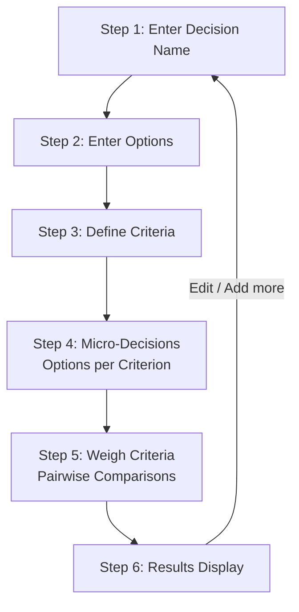

# DecisionHelper — Paper Prototype

> **Scenario:** A user decides what food to order tonight (*Pizza, Sushi, Burger*). They specify criteria (*Healthiness, Price, Tastiness*), execute quick micro-decisions comparing options per criterion, weigh the criteria against each other, and receive a clear, ranked decision.

---

## User Flow Overview



---

## Step 1 — Decision Name

The user names the decision to give the session clarity and purpose.

```
┌─────────────────────────────────────────────┐
│  DecisionHelper                          ⋮  │
│─────────────────────────────────────────────│
│                                             │
│  What decision are you making?              │
│                                             │
│  ┌─────────────────────────────────────┐   │
│  │  e.g. "What should I order tonight?"│   │
│  └─────────────────────────────────────┘   │
│                                             │
│          [ Next: Add Options → ]            │
│                                             │
└─────────────────────────────────────────────┘
```

**Interactions:**
- Type title and press Enter or tap "Next: Add Options".
- Unlocks when title is not empty.

---

## Step 2 — Enter Options

The user enters the alternatives they are choosing between.

```
┌─────────────────────────────────────────────┐
│  ← Title               Options          ⋮   │
│─────────────────────────────────────────────│
│  Decision: What should I order tonight?     │
│                                             │
│  What are your options?                     │
│  ┌───────────────────────┐ ┌──────────────┐ │
│  │ e.g. "Pizza"          │ │ [ + Add ]    │ │
│  └───────────────────────┘ └──────────────┘ │
│                                             │
│  ── Added Options (3) ─────────────────────  │
│                                             │
│  ● Pizza                              [ × ] │
│  ● Sushi                              [ × ] │
│  ● Burger                             [ × ] │
│                                             │
│  (Need at least 2 options)                  │
│                                             │
│          [ Next: Define Criteria → ]        │
└─────────────────────────────────────────────┘
```

**Interactions:**
- Type option + tap "Add" (or press Enter).
- Tap `×` to delete an option.
- "Next: Define Criteria" unlocks when $\ge 2$ options are present.

---

## Step 3 — Define Criteria

The user adds the criteria they care about.

```
┌─────────────────────────────────────────────┐
│  ← Options            Criteria          ⋮   │
│─────────────────────────────────────────────│
│  Decision: What should I order tonight?     │
│                                             │
│  What criteria matter to you?               │
│  ┌───────────────────────┐ ┌──────────────┐ │
│  │ e.g. "Price"          │ │ [ + Add ]    │ │
│  └───────────────────────┘ └──────────────┘ │
│                                             │
│  ── Added Criteria (3) ───────────────────  │
│                                             │
│  ◆ Healthiness                        [ × ] │
│  ◆ Tastiness                          [ × ] │
│  ◆ Price                              [ × ] │
│                                             │
│  (Need at least 1 criterion)                │
│                                             │
│          [ Start Micro-Decisions → ]        │
└─────────────────────────────────────────────┘
```

**Interactions:**
- Type criterion + tap "Add".
- Tap `×` to remove.
- "Start Micro-Decisions" unlocks when $\ge 1$ criterion is present.

---

## Step 4 — Micro-Decisions (Options per Criterion)

For a specific criterion, two options are presented.
**Key UX Rule:** The "Equal" choice is given equal sizing, equal touch target, and equal visual weight as the two options.

```
┌─────────────────────────────────────────────┐
│  ← Back        Question 2 of 6          ⋮   │
│─────────────────────────────────────────────│
│                                             │
│  Criterion: Healthiness                     │
│  Which option is better for this?           │
│                                             │
│  ┌───────────────────────────────────────┐  │
│  │                                       │  │
│  │                Pizza                  │  │
│  │                                       │  │
│  └───────────────────────────────────────┘  │
│                                             │
│  ┌───────────────────────────────────────┐  │
│  │                                       │  │
│  │            Equally Good               │  │
│  │                                       │  │
│  └───────────────────────────────────────┘  │
│                                             │
│  ┌───────────────────────────────────────┐  │
│  │                                       │  │
│  │                Sushi                  │  │
│  │                                       │  │
│  └───────────────────────────────────────┘  │
│                                             │
│  Progress: [████████░░░░░░░░░░░░] 33%       │
└─────────────────────────────────────────────┘
```

**Interactions:**
- Tap any of the 3 cards to record preference (+1 to winner, +0.5 to both if Equal).
- No sliders, no continuous numbers, no guesswork.
- Automatically transitions to the next pair or next criterion.

---

## Step 5 — Weigh Criteria (Pairwise)

To avoid overweighting the #1 criterion (the problem with drag-ranking), the user compares criteria pairwise. This naturally allows multiple top criteria to share equal weight.

```
┌─────────────────────────────────────────────┐
│  ← Back        Criteria Weighting       ⋮   │
│─────────────────────────────────────────────│
│                                             │
│  Which criterion matters more to you?       │
│                                             │
│  ┌───────────────────────────────────────┐  │
│  │                                       │  │
│  │             Healthiness               │  │
│  │                                       │  │
│  └───────────────────────────────────────┘  │
│                                             │
│  ┌───────────────────────────────────────┐  │
│  │                                       │  │
│  │            Equally Important          │  │
│  │                                       │  │
│  └───────────────────────────────────────┘  │
│                                             │
│  ┌───────────────────────────────────────┐  │
│  │                                       │  │
│  │              Tastiness                │  │
│  │                                       │  │
│  └───────────────────────────────────────┘  │
│                                             │
│  Progress: [████████████░░░░░░░░] 50%       │
└─────────────────────────────────────────────┘
```

**Interactions:**
- If the user considers Healthiness and Tastiness equally important, tapping "Equally Important" assigns identical weights to both.
- 3 cards are equally sized and highlighted.

---

## Step 6 — Results Display

The final results are displayed clearly and transparently.

```
┌─────────────────────────────────────────────┐
│  Decision Results                       ⋮   │
│─────────────────────────────────────────────│
│  Decision: What should I order tonight?     │
│                                             │
│  🏆 Recommended Choice:                     │
│  ╔════════════════════════════════════════╗ │
│  ║  1. Sushi                        82%   ║ │
│  ╚════════════════════════════════════════╝ │
│                                             │
│  ── All Rankings ─────────────────────────  │
│                                             │
│  1. Sushi            [████████░░]   82%     │
│     Healthiness: 100% | Tastiness: 70%      │
│                                             │
│  2. Pizza            [██████░░░░]   61%     │
│     Tastiness: 90% | Price: 65%             │
│                                             │
│  3. Burger           [████░░░░░░]   43%     │
│                                             │
│  ── Criteria Importance ──────────────────  │
│  • Healthiness: 40%                         │
│  • Tastiness:   40%  (Tied with Healthiness)│
│  • Price:       20%                         │
│                                             │
│  [ Start New Decision ]   [ Adjust Answers ]│
└─────────────────────────────────────────────┘
```

**Features:**
- Clear percentage ranking based on weighted scores.
- Breakdown per criterion.
- Tied criteria clearly surfaced as equal partners.
- Options to restart or fine-tune.
